# OpenVario assembly

Assembly of the Cubieboard OpenVario: adapter board stacked on a Cubieboard,
sensorboard, four-socket connectorboard, and sheet-metal case.

Based on Guido Probst’s assembly guide of 1 December 2014,
[CC BY-SA](https://ftp.openvario.org/Open%20Vario%20Assembly%20Guide.pdf).

BOM, schematics, and variant CAD: [Manufacturing](../manufacturing/).
After assembly: [Installation guide](../installation/).
Separate 7″ assembly PDF:
[Openvario_7in_assembly.pdf](https://ftp.openvario.org/Openvario_7in_assembly.pdf).

## Contents

- [Parts](#parts)
- [Case](#case)
- [Power](#power)
- [Stack](#stack)
- [Display cable](#display-cable)
- [Fit the electronics](#fit-the-electronics)
- [Finished unit](#finished-unit)

## Parts

**Electronic parts**

- Adapter board
- Connectorboard
- Sensorboard
- Pressure-hose barbs

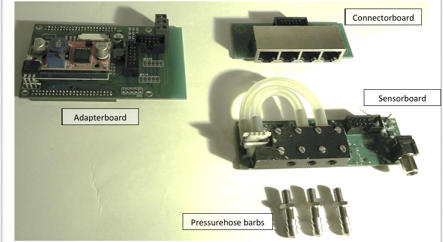

**Cubieboard**

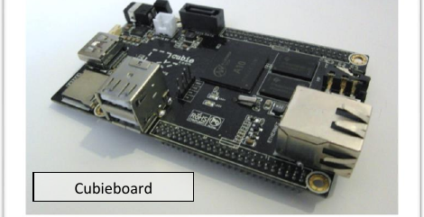

**LCD and touchscreen**

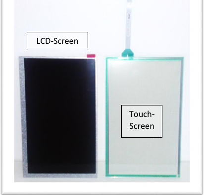

**Housing**

Front frame, back frame, distance plates, lower and upper housing covers,
upper backplate, and lower backplate.

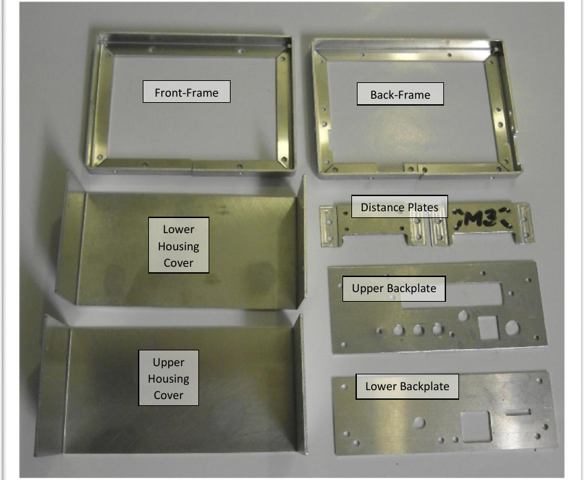

**Front plate**

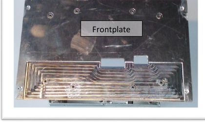

**Faceplate**

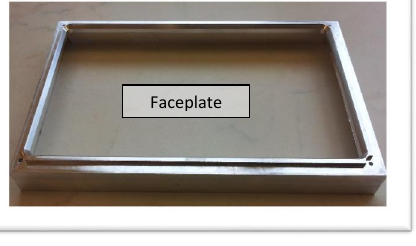

## Case

Countersink before bending the parts.

**Countersinks on the frames**

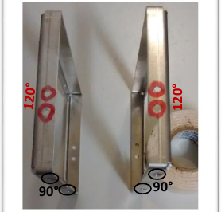

**Countersinks and threads**

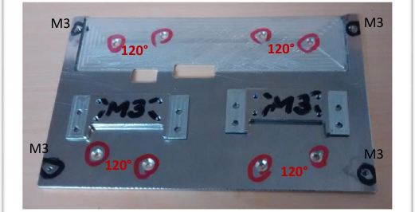

Red marks are a 120° countersink for the rivets, about 6 mm. On 1.5 mm sheet
the black marks are a 90° countersink. On 3 mm sheet the black marks are an
M3 thread.

Eight rivets join the two frames to the two distance plates.

**Frames and distance plates**

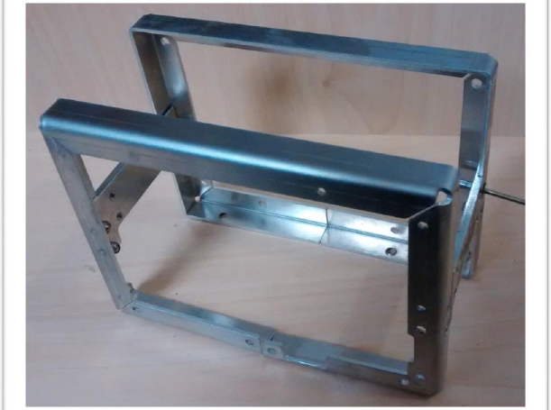

Mount the front plate and the lower backplate on the frames. The USB and LCD
cable holes face the bottom.

**Front plate and lower backplate**

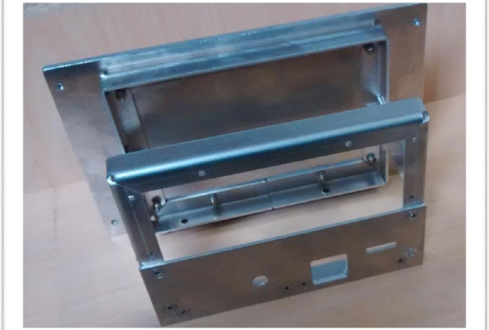

Four threaded standoffs hold the Cubieboard.

**Cubieboard standoffs**

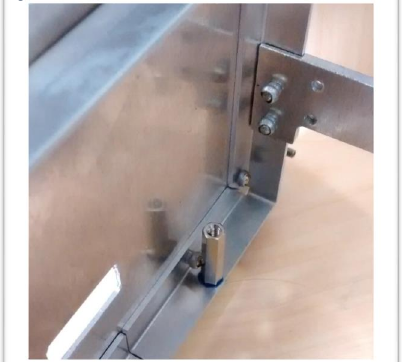

Four M3×16 studs go through the front plate with high-strength thread locker.
Flush on the front, hexagon head aft. A nut and washer hold each stud until
the locker cures.

**Front-plate studs**

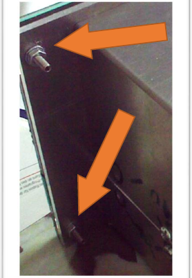

## Power

Set the adapter-board DC/DC converter to 5 V with the blue trimmer.

**5 V and 3.3 V check**

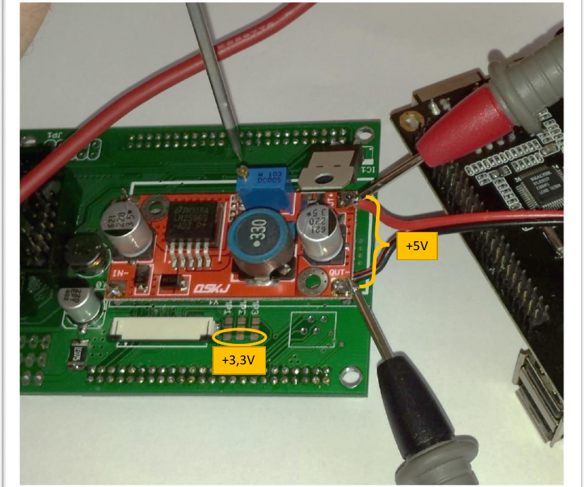

The output capacitor is +5 V. The pin row beside it is +3.3 V. Connect the
Cubieboard and the LCD only after both rails are right.

## Stack

Solder the supply from the adapter board.

**Supply, adapter end**

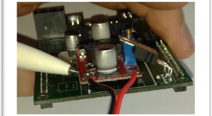

**Supply, other end**

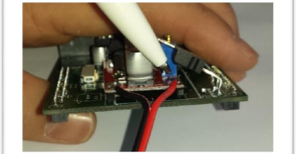

…to the Cubieboard.

**Supply on the Cubieboard**

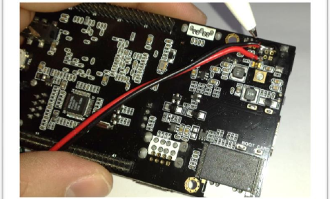

The outer edges of the two boards must line up. The headers can mate 2 mm off.

**Board alignment**

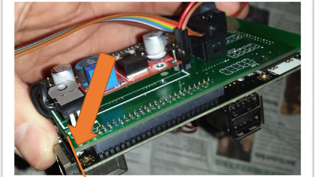

Jumper UART0 RX and TX from the Cubieboard.

**UART0 on the Cubieboard**

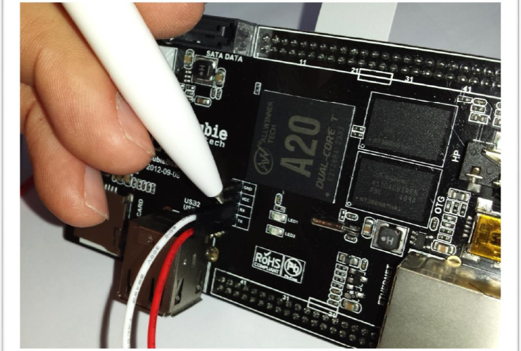

…to the adapter, which has the same pin layout. The photos do not label which
wire is RX.

**UART0 on the adapter**

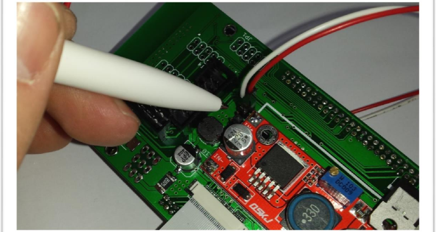

Cut one jumper and solder it to the middle contact of the Cubieboard
headphone jack.

**Headphone jack**

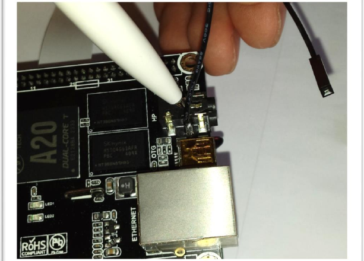

That wire later goes to the amplifier pin on the sensorboard.

Connect three wires to the 12 V outlet on the adapter:

- +12 V supply
- ground
- +12 V for an external device, such as FLARM

**12 V outlet**

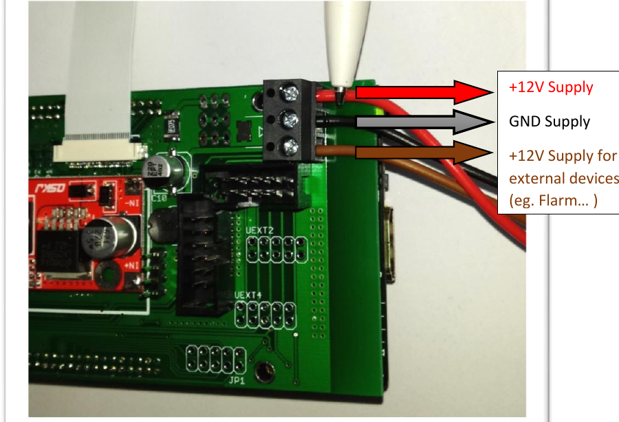

Knot the cable as the strain relief.

**Strain relief**

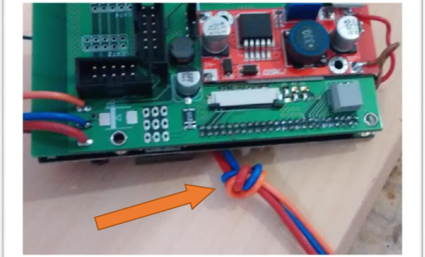

Check the jumpers. In the guide, JP1 is closed and JP2 and JP3 are open.

**Jumpers**

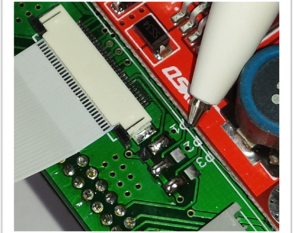

- JP1 mirrors up / down
- JP2 mirrors left / right
- JP3 selects backlight PWM, or 3.3 V fixed

## Display cable

Connect the display cable. The two ends are not the same.

On the adapter the latch slides out and the contacts face away from the board.

**Display cable on the adapter**

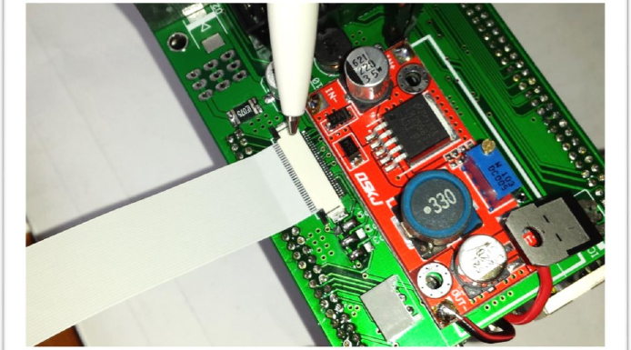

On the LCD the latch flips up and the contacts face the panel.

**Display cable on the LCD**

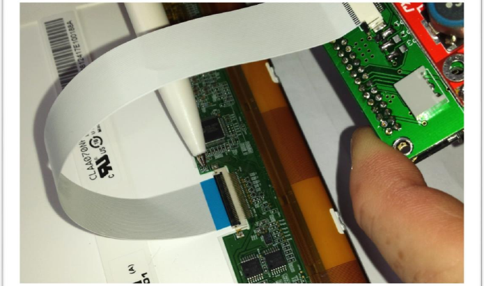

Run the whole system before it goes into the case.

## Fit the electronics

Spacer bushings go between the Cubieboard and the adapter.

**Spacer bushings**

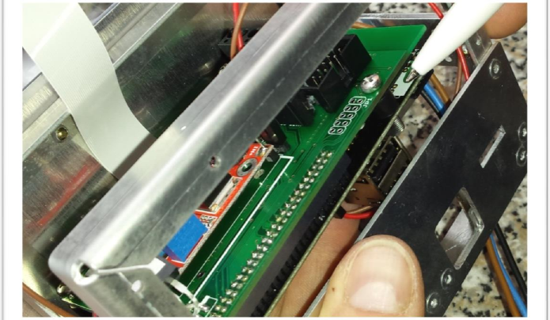

Screw that stack onto the standoffs.

**Stack on the standoffs**

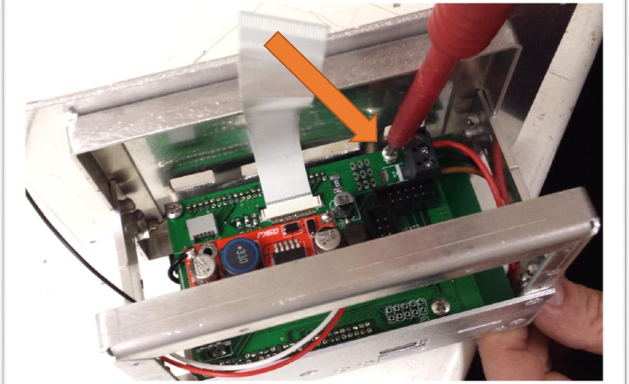

Check the alignment.

**Alignment in the housing**

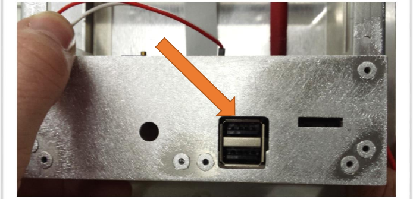

The sensorboard is held to the upper backplate by the three hose barbs.

**Hose barbs**

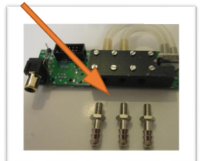

**Sensorboard**

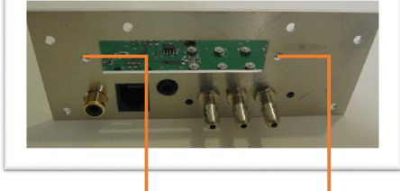

Screw the connectorboard to the same plate.

**Connectorboard**

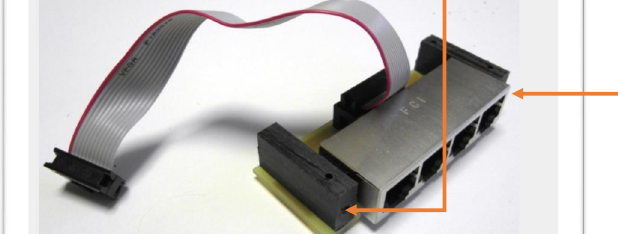

Connect the audio wire to the amplifier pin on the sensorboard.

**Audio wire**

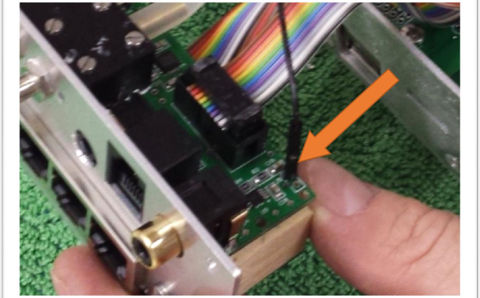

Join the sensorboard with a 10-pin ribbon, pin 1 to pin 1. The photo does not
mark which end is pin 1.

**Sensorboard ribbon**

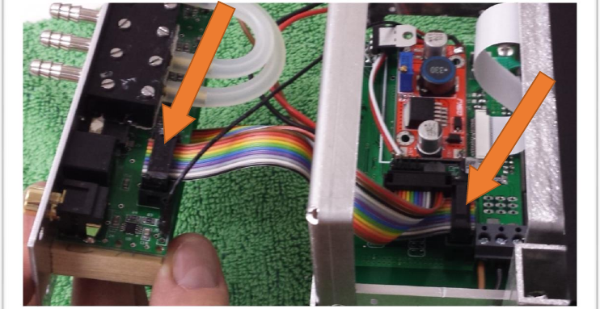

Join the connectorboard with a 12-pin ribbon, pin 1 to pin 1.

**Connectorboard ribbon**

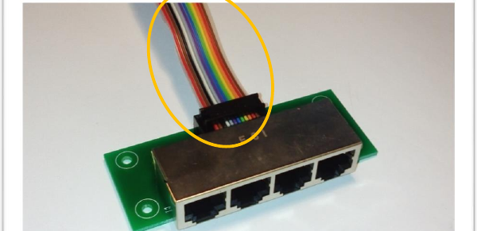

**Ribbon on the adapter**

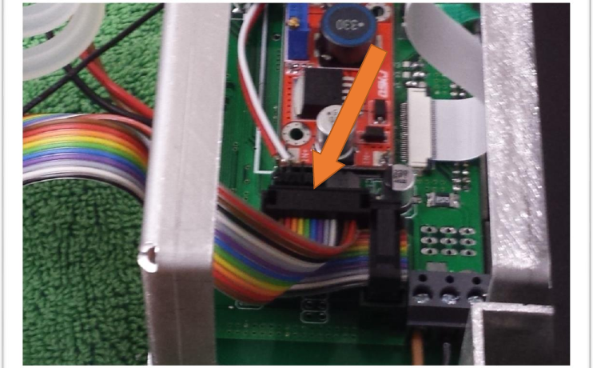

Connect the LCD and the touchscreen.

**LCD and touchscreen cables**

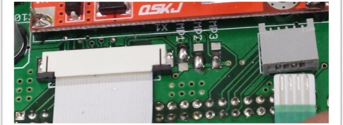

Tape the LCD to the front plate with double-sided tape on the marked strips.
Keep the touchscreen cable clear.

**LCD tape**

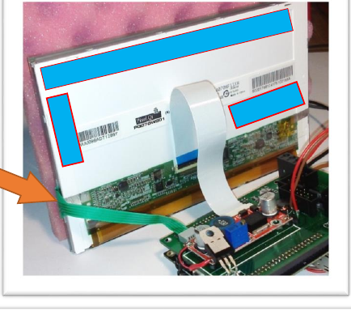

Bond the LCD on the marked edges. The front frame, mounted next, clamps the
touchscreen.

**LCD on the front plate**

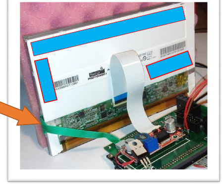

Two aluminium profiles, about 98×10×5 mm, go on the back of the front plate.
Adjust the frame for the thickness of the LCD, the touchscreen, and the tape.
Drill 1.6 mm through the frame and the profiles, cut M2 threads in the
profiles, countersink the frame, and fix it with M2×5 flat-head screws.

**Front frame**

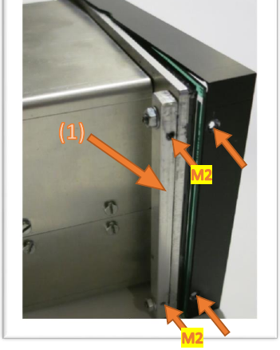

A grommet goes in the lower backplate cable hole.

**Grommet**

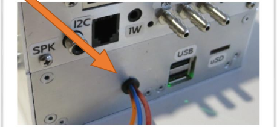

Fit the lower and upper covers.

**Housing covers**

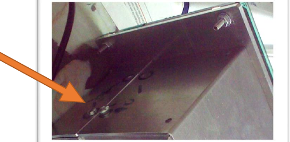

## Finished unit

**Finished OpenVario**

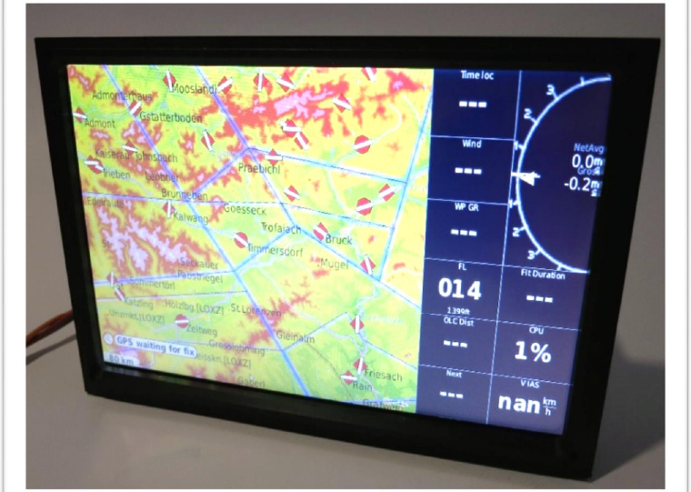

**Back panel**

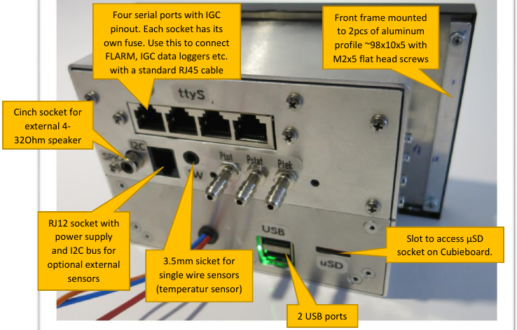

- Four RJ45 serial ports, IGC pinout, each with its own fuse, for FLARM and
  IGC loggers on a standard RJ45 cable
- Front frame on two aluminium profiles, about 98×10×5 mm, with M2×5 flat-head
  screws
- Cinch socket for a 4–32 Ω speaker
- RJ12 with power and I2C for an external sensor
- 3.5 mm jack for a single-wire temperature sensor
- Two USB ports
- Slot through to the Cubieboard microSD socket
