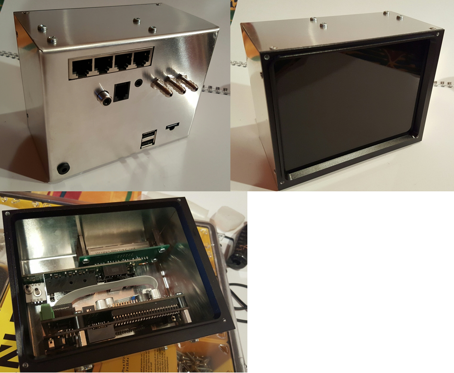
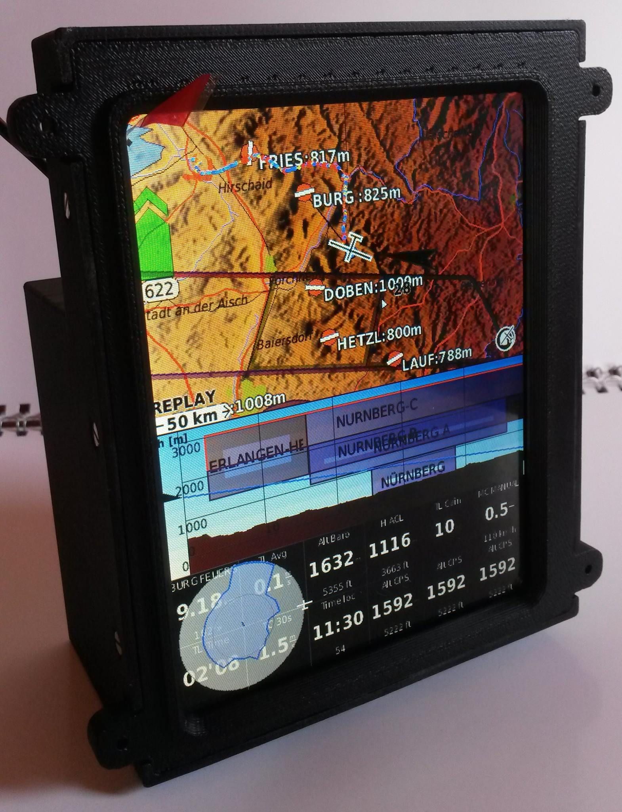

# Panel cutout

Housings differ by display size and are not interchangeable. Measure the unit
to be installed — [Variants](../manufacturing/variants.md).

**W × H** is the panel aperture (front face). **D** is case depth behind the
panel. Use the full case depth, not the front-plate thickness alone. Allow
space for connectors, hoses, and microSD access.

## Dimensions

Figures are rendered from FTP housing meshes. The red box is the outer
envelope.

| Variant | STL base | W × H × D (mm) | Figure |
|---------|----------|----------------|--------|
| **5.7″** front (cutout) | `5,7_Front_Alu.stl` | **133.4 × 104.8 × 10** | [iso-57lvds-front.png](figures/cutouts/iso-57lvds-front.png) |
| **5.7″** full 3D-print case | `Front_3D_Print` + `Back_3D_Print` | **≈135 × 126.4 × 62** | [iso-57lvds-case.png](figures/cutouts/iso-57lvds-case.png) |
| **4.3″** front (cutout) | `Frontcover.stl` | **126.5 × 72.5 × 4.8** | [iso-43rgb-front.png](figures/cutouts/iso-43rgb-front.png) |
| **4.3″** full case | Frontcover + sideframes + Backpanel | **126.5 × 72.5 × ≈103** | [iso-43rgb.png](figures/cutouts/iso-43rgb.png) |
| Classic **7″** | Outside_Dimensions DXF (no STL) | **169 × 106.5 × 80.2** | [measurements](figures/cutouts/measurements.md) |

SteFly quotes approximately **80 mm** depth for production sheet-metal housings.
Open 5.7″ 3D-print kit STLs are shallower (≈62 mm). Measure the installed unit.
CH70/PQ70 housings are not published as STL on FTP.

CAD references: [FreeCAD model](https://ftp.openvario.org/OV_Flight_Computer.FCStd),
[7″ assembly PDF](ftp://ftp.openvario.org/Openvario_7in_assembly.pdf).

## Templates (1:1)

Print at **100%** scale (do not fit to page). Verify a printed scale bar or
ruler before cutting. Templates show outer outline, screen aperture, and screw
centres.

| Variant | Template | Screen (mm) | Screws |
|---------|----------|-------------|--------|
| 5.7″ | [cutout-57lvds.svg](figures/cutouts/cutout-57lvds.svg) | 116.95 × 88.03 | 4× Ø≈2.0 |
| 4.3″ | [cutout-43rgb.svg](figures/cutouts/cutout-43rgb.svg) | 100.99 × 59.75 | 4× Ø≈2.7 |
| 7″ classic | [cutout-7in-classic.svg](figures/cutouts/cutout-7in-classic.svg) | — | 4× Ø2.0 |

Detailed tables: [measurements.md](figures/cutouts/measurements.md).

## Tolerance

The CAD outline matches the housing. Open the cutout slightly:

| Practice | Clearance |
|----------|-----------|
| SteFly CNC | ≈**0.17 mm** outward mill offset |
| Typical | ≈**0.15–0.2 mm** per side |
| Paint after cutting | Additional **0.1–0.3 mm** per side |

## Clearance behind the panel

Use case depth **D** from the full-housing figure. Reserve space for
connectors, hoses, microSD access, and the
[panel USB](power.md#panel-usb) extension.

Previous: [System planning](system-planning.md). Next:
[Power and fuses](power.md) → [Pneumatics](pneumatics.md).
