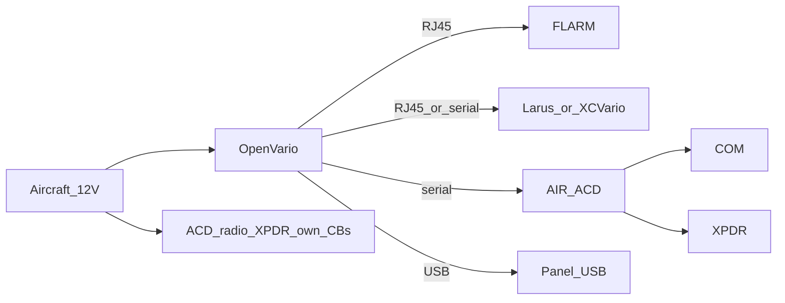

# Sample installation

Example system: OpenVario with AIR ACD, Larus *or* XCVario, and optional FLARM.
Not an airframe drawing. Follow each peer device's manual.

Related: [System planning](system-planning.md).

| Unit | Role |
|------|------|
| **OpenVario** | Navigation computer (XCSoar); optional sensorboard |
| **AIR ACD** | Radio and Mode‑S control (driver `ACD`) |
| **Larus** or **XCVario** | External variometer (one device) |
| **FLARM** | Optional traffic / GPS on RJ45 |

Wire the radio and transponder to the ACD as in the AIR documentation.
XCSoar uses serial to the ACD (frequency and squawk).

## Panel USB

Extend one USB port to the panel for storage devices, network adapters, Stick
Remote, or keyboard — [Power](power.md#panel-usb).

## XCSoar Devices

**With sensorboard**

| Device | Driver | Port |
|--------|--------|------|
| A | OpenVario | TCP **4352** |
| B | Larus or XCVario | assigned `ttyS*` |
| C | ACD | assigned `ttyS*` |
| D | FLARM | remaining `ttyS*` |

**Without sensorboard:** place the external variometer or GPS on Device A; do
not configure OpenVario TCP —
[Hardware options](../user-guide/hardware-options.md).

Baud rates follow each peer device’s documentation. Verify traffic on the
Devices monitor.

## Power and pinouts

OpenVario supply: [Power](power.md). IGC peers may draw +12 V on RJ45 pins 1–2
(500 mA per port). ACD, COM, and XPDR require their own circuit protection.

OpenVario RJ45: [Hardware connectors](../user-guide/hardware-connectors.md).
ACD, Larus, and XCVario cabling: manufacturer documentation only.

After wiring:

[Choose an image](choose-image.md) → [Write the SD card](write-sd-card.md) →
[First boot](first-boot.md) → [Checklist](checklist.md).
