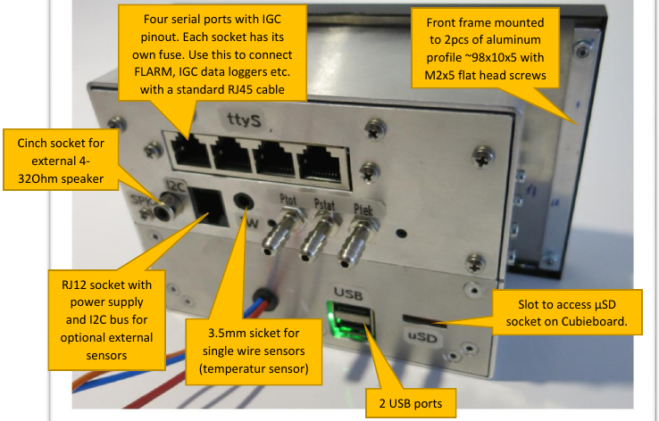
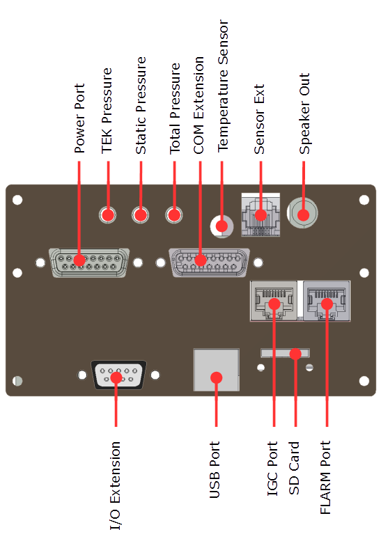
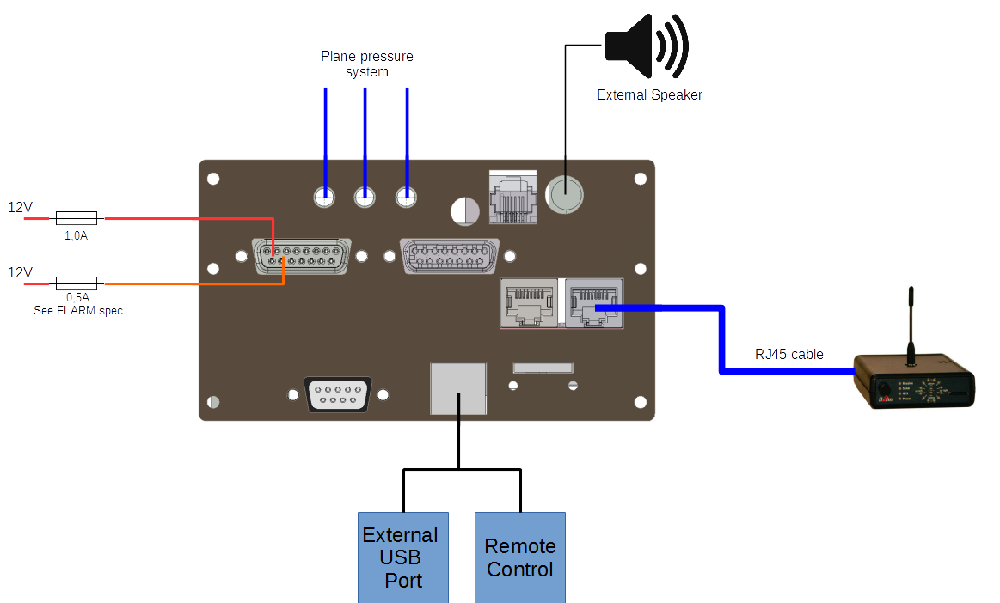
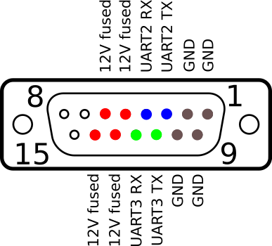
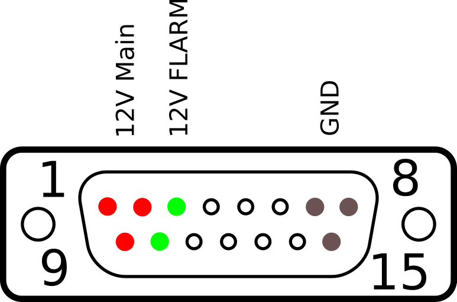

# Hardware connectors

Connector layouts vary by display housing. Incorrect power connections can
damage OpenVario and peer equipment.
[Power](../installation/power.md) · [Variants](../manufacturing/variants.md) ·
[Assembly](../assembly/).

## Open connectorboard (Cubieboard builds)

Open-source housing: four fused RJ45 serial ports, speaker, I2C,
one-wire sensor jack, USB, microSD access, and three pressure barbs when a
sensorboard is fitted.

| Port | Use |
|------|-----|
| 4× RJ45 | RS‑232, IGC pinout; FLARM / loggers / peers |
| Cinch (SPK) | Speaker 4–32 Ω |
| RJ12 (I2C) | Power + I2C external sensor |
| 3.5 mm (1W) | One-wire temperature probe |
| 2× USB | Sticks, Wi‑Fi, Stick Remote — extend one to the [panel](../installation/power.md#panel-usb) |
| microSD slot | Cubieboard card access |
| Ptot / Pstat / Ptek | Pitot / static / TEK ([Pneumatics](../installation/pneumatics.md)) |

### RJ45 (IGC)

Each jack is fused at **500 mA**. Pins **1–2** can supply **+12 V** to IGC
peers on a 1:1 cable.

| Pin | Function |
|-----|----------|
| 1–2 | +12 V (fused) |
| 3–4 | often unused on simple data cables |
| 5 | RX (OpenVario receives) |
| 6 | TX (OpenVario transmits) |
| 7–8 | GND |

Not every peer is IGC; some must not take +12 V on 1–2. Each jack is a
`ttyS*` in XCSoar **Devices** — mapping depends on board revision; label the
jack and check the NMEA monitor.

## 4.3″ variant (legacy user-guide figures)

The older 4.3″ documentation shows a different backplate (D‑Sub power / COM
extension, dedicated FLARM RJ45, etc.). Commercial panels (e.g. SteFly) may
also use D‑Sub layouts that do **not** match the open connectorboard above.

### Back panel

Labels include TEK / static / total pressure, power port, COM (OOV) extension,
temperature sensor, sensor extension, speaker, I/O extension, USB, microSD,
RS‑232, and FLARM.

### Wiring overview

Aircraft 12 V into the power connector (with fusing as labelled on that
drawing), pressure system to the three barbs, speaker, FLARM on RJ45, USB /
remote via the I/O area.

### COM extension

High-density D‑Sub, mating face. Use the harness made for that housing.

### Power port

Power and FLARM feed pins as drawn on that 4.3″ backplate. Open
connectorboard builds use the [Power](../installation/power.md) fuse ratings:
**1.5 A** main, **500 mA** per RJ45.

## Schematics

Board-level pinouts: [Schematics and PCB](../manufacturing/schematics-and-pcb.md).
